# Improved Shark Algorithm Optimization, extremely effective! Best performance on all five classic test sets! Highly recommended! MATLAB code

Sand Cat Swarm Optimization (SCSO) is a new metaheuristic algorithm proposed by Amir Seyyedabbasi and Farzad Kiani in 2022. This algorithm mimics the survival behavior of sand cats in nature, serving as an intelligent optimization algorithm. Currently, this algorithm can be searched for its citation count on Google Scholar, which stands at 106. The principle of SCSO is simple, but its search optimization effect is indeed excellent, and many people are currently improving this algorithm!
The new algorithm introduced in this issue is the Sand Cat Swarm Optimization with a Sparrow Alarm Mechanism and Helical Search (SSCSO). This abbreviation was created by the author for differentiation from the original SCSO, and you can modify it according to your own ideas.
The integration of the sparrow alarm mechanism is the result of the author's careful consideration of the original SCSO and continuous research over a long period.
Improvements:
①Tested on five classic test sets
In the CEC2005, CEC2017, CEC2019, CEC2021, and CEC2022 five classic test sets, the Sand Cat Swarm Optimization with a Sparrow Alarm Mechanism and Helical Search (SSCSO) performed best!
②Program can be run once, automatically generating statistical tables.
Each algorithm runs 30 times, and an Excel table can be automatically generated in the current directory. In addition to calculating the average, best value, standard deviation, worst value, and median value of each algorithm, there is another table specifically for the results of rank sum tests.
③Does not increase the complexity of the original algorithm
This algorithm does not repeatedly call the fitness function in loops, does not add so-called greedy strategies, or reverse learning methods that increase complexity.
④Compared with various intelligent algorithms
This period's algorithm comparison experiment involved six other highly efficient or popular intelligent algorithms. These include: the Original Sand Cat Swarm Optimization (SCSO), the Beetle Algorithm (DBO), the Pelican Optimization Algorithm (POA), the Subtraction Optimizer Algorithm (SABO), and the Harris Hawk Optimization Algorithm (HHO).
Detailed Explanation of Improvement Strategies
There are many explanations online about the principles of the Sand Cat Swarm Algorithm, which I have previously introduced in a previous article. This article will not elaborate further on this topic, but instead, we will directly move to the improvement strategies:
Improvement Point 1: Adding Cubic Chaos Map to Increase the Diversity of the Sand Cat Swarm
The addition of the Cubic Chaos Map primarily aims to increase the diversity of the initialization of the Sand Cat Swarm. Those interested in switching to another chaos map can refer to this article: 10 Chaos Map Optimization for Grey Wolf Algorithm, allowing for one-click switching.
The formula for the Cubic Chaos Map is as follows:
Taking x0=0.3, ρ=2.595, the Cubic map has good chaos traversability. The following two graphs can be run with plotchaos.m.
Improvement Point 2: Integrating a Helical Search Strategy into the Sand Cat Swarm's Prey Search Phase
Integrating a helical search strategy into the prey search phase allows the sand cats to have multiple search paths to better adjust their positions, thereby enhancing the algorithm's global search performance.
The original Sand Cat Swarm Algorithm's prey search phase formula is as follows:
Adding a helical search factor:
After integrating the helical search factor, the formula becomes:
By integrating the helical exploration, the sand cats will search in a spiral form within the search space, expanding the ability to explore unknown areas, increasing the likelihood of breaking out of local optima, and effectively improving the algorithm's global search performance.
Improvement Point 3: Merging a Sparrow Alert Mechanism
In the second phase of the Sand Cat Algorithm, an additional Sparrow Alert Mechanism is added. Although Sand Cats live in deserts for a long time, they are still discovered by predators such as wild dogs, foxes, wolves, some venomous snakes, and various raptors. The presence of these predators makes the Sand Cats extremely sensitive and cautious: therefore, it is believed that integrating the Sparrow's alert mechanism with the Sand Cat Algorithm can enhance its convergence speed.
When the Sand Cats sense danger, the sand cats at the edge of the group will quickly move towards a safer area to obtain better positions, while those in the middle of the population will randomly walk to approach other sand cats.
The algorithm principle will be explained in a zip file with a dedicated word document.
Results show:
Tested in CEC2005:
Here are some screenshots showing the excellent test results of the CEC2005 function.
Each algorithm iteration is set to 500 times, with a population size of 30, and each function runs 30 times to find the optimal value, standard deviation, mean, worst value, median, and five other indicators such as rank sum test results and box plots.
Five indicator results:
Rank sum test results:
Box plot:
Tested in CEC2017:
Here are some screenshots showing the excellent test results of the CEC2019 function.
Each algorithm iteration is set to 500 times, with a population size of 30, and each function runs 30 times to find the optimal value, standard deviation, mean, worst value, median, and five other indicators such as rank sum test results and box plots.
Five indicator results:
Rank sum test results:
Box plot:
Tested in CEC2019:
Due to space reasons, only the box plot is shown here; from the box plot, the effectiveness of the algorithm can also be fully demonstrated.
Tested in CEC2021:
Due to space reasons, only the box plot is shown here; from the box plot, the effectiveness of the algorithm can also be fully demonstrated.
Tested in CEC2022:
Due to the length of this text, only the box plot is included here. The effect of the algorithm can also be clearly seen from the box plot.

Code Exhibits:
The code directory is as follows:
Each file has a subdirectory as follows, for example, CEC2005 and CEC2017:
Each file contains a program for plotting (plotCEC2005_Main.m, plotCEC2017_Main.m) and a program for generating statistical indicators in Excel and box plots (runsCEC2005_Main.m, runsCEC2017_Main.m).
After running, a table will be directly generated, where result.xls is the optimal value, standard deviation, mean, worst value, median indicator statistical results, and ranksumresult.xls is the rank sum test result.
Some code excerpts:
RESULT=[];   % Calculate standard deviation, mean, optimal value, etc.\nrank_sum_RESULT=[];  % Calculate the rank sum test results\n​\nF = [1 2 3 4 5 6 7 8 9 10 11 12 13 14 15 16 17 18 19 20 21 22 23];\n​\nif box_pp ==1\n    figure('Name', 'Box plot', 'Color', 'w','Position', [50 50 1400 700])\nend\n​\nfor func_num = 1:length(F)    %CEC2005 has 23 functions\n    % Display the comprehensive results\n    disp(['F',num2str(F(func_num)),'Function calculation results: '])\n    [lower_bound,upper_bound,variables_no,fhd]\n=Get_Functions_details([\n'F'\n,num2str(F(func_num))]);    resu = [];  % Calculate standard deviation, mean, optimal value, etc.\n    rank_sum_resu = [];   % Calculate the rank sum test results\n    box_plot = [];  % Statistical box plot results\n    %% Run the SSCSO algorithm for "run" times\n    for nrun=1:run\n        [final,position,iter]=SSCSO(pop_size,max_iter,lower_bound,upper_bound,variables_no,fhd);\n        final_main(nrun)=final;\n        z1(nrun) =  final;\n    end\n    box_plot = [box_plot;final_main]; % Statistical box plot results\n    zz = [min(final_main);std(final_main);mean(final_main);median(final_main);max(final_main)];\n    resu = [resu,zz];\n    disp(['SSCSO: Optimal value:',num2str(zz(1)),' Standard deviation:',num2str(zz(2)),' Mean:',num2str(zz(3)),' Median:',num2str(zz(4)),' Worst value:',num2str(zz(5))]);\n    %% Run the DBO algorithm for "run" times\n    for nrun=1:run\n        [final,position,iter]=DBO(pop_size,max_iter,lower_bound,upper_bound,variables_no,fhd);\n        final_main(nrun)=final;\n        z2(nrun) =  final;\n    end\n    box_plot = [box_plot;final_main]; % Statistical box plot results\n    zz = [min(final_main);std(final_main);mean(final_main);median(final_main);max(final_main)];\n    resu = [resu,zz];\n    rs = ranksum(z1,z2);\n    if isnan(rs)  % When z1 and z2 are exactly the same, a NaN value will occur, which is very unlikely. However, it is necessary to prevent errors.\n        rs\n=\n1\n;    end\n    rank_sum_resu = [rank_sum_resu,rs]; % Calculate the rank sum test results\n    disp(['DBO: Optimal value:',num2str(zz(1)),' Standard deviation:',num2str(zz(2)),' Mean:',num2str(zz(3)),' Median:',num2str(zz(4)),' Worst value:',num2str(zz(5))]);\n\n  

## Images

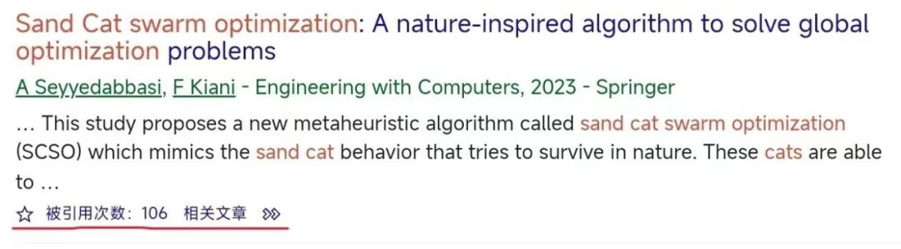
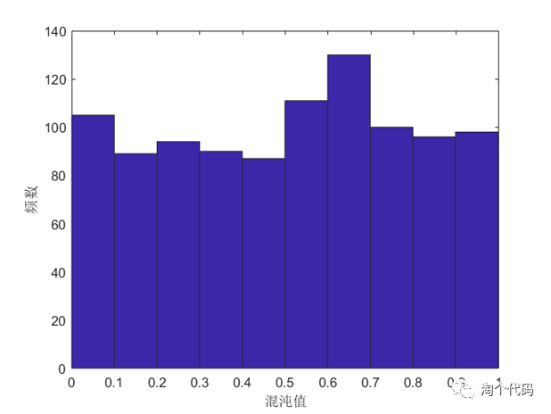
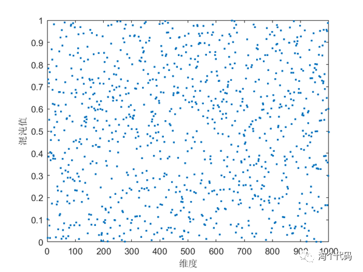
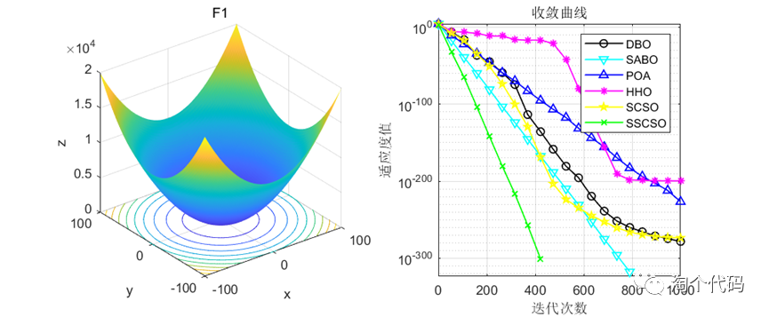
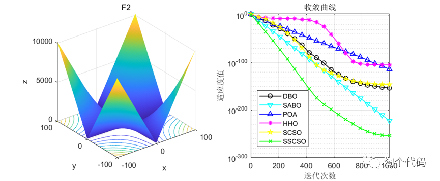
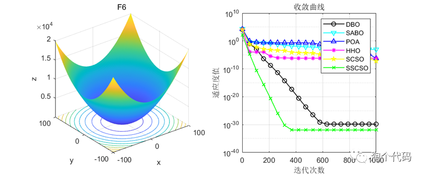
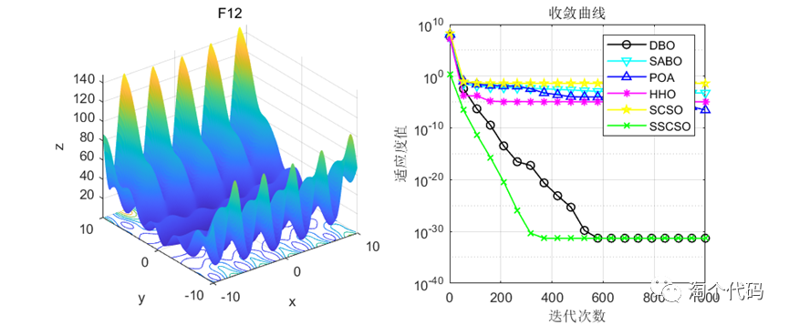
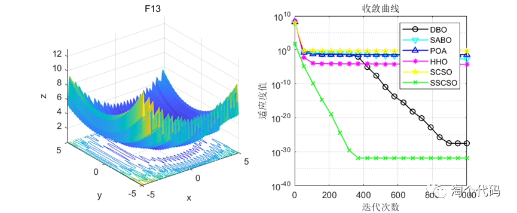
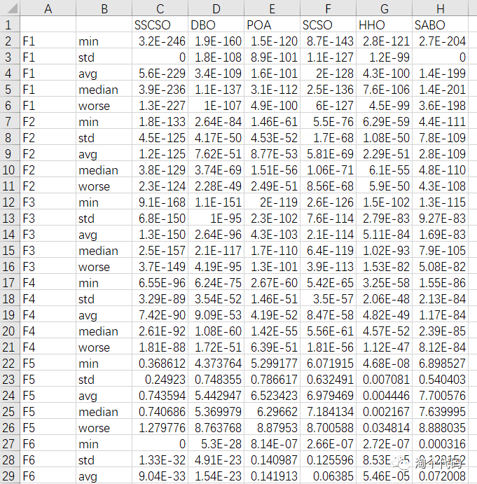
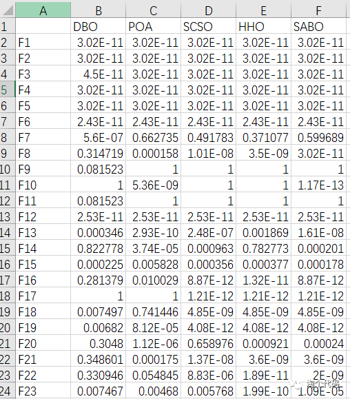
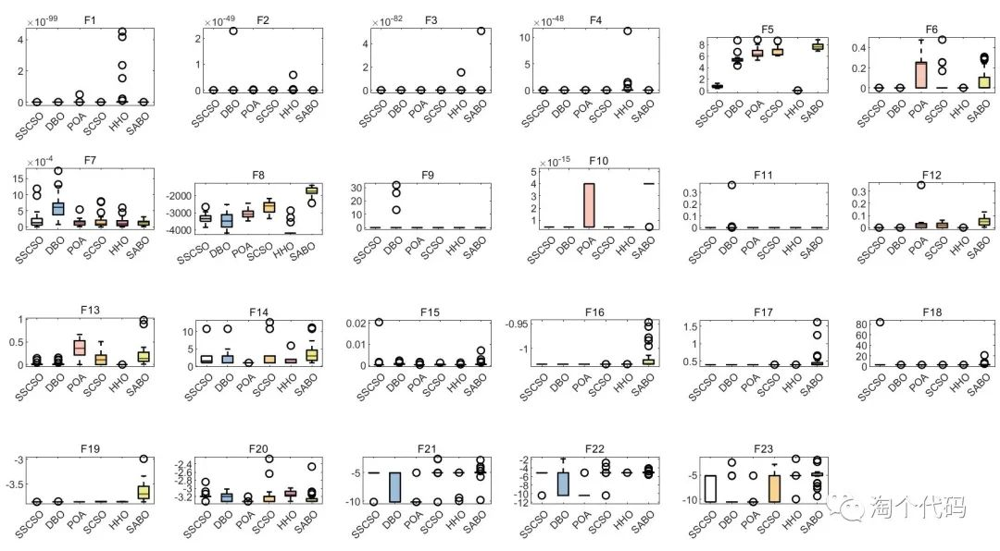
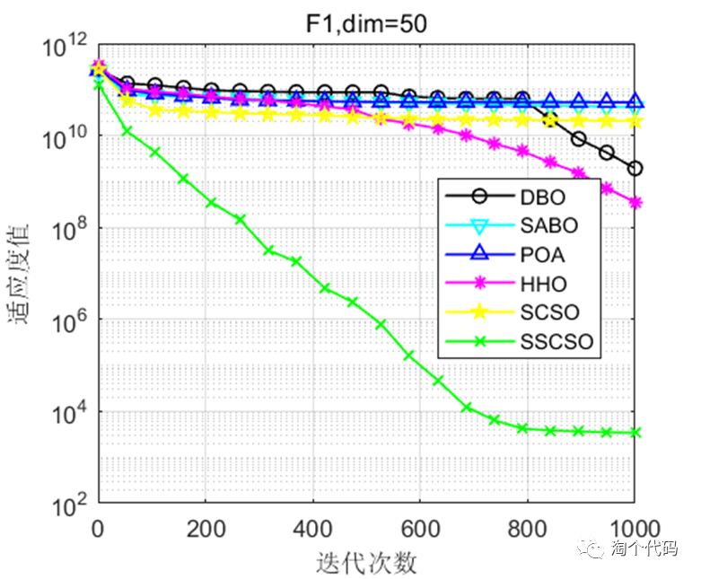
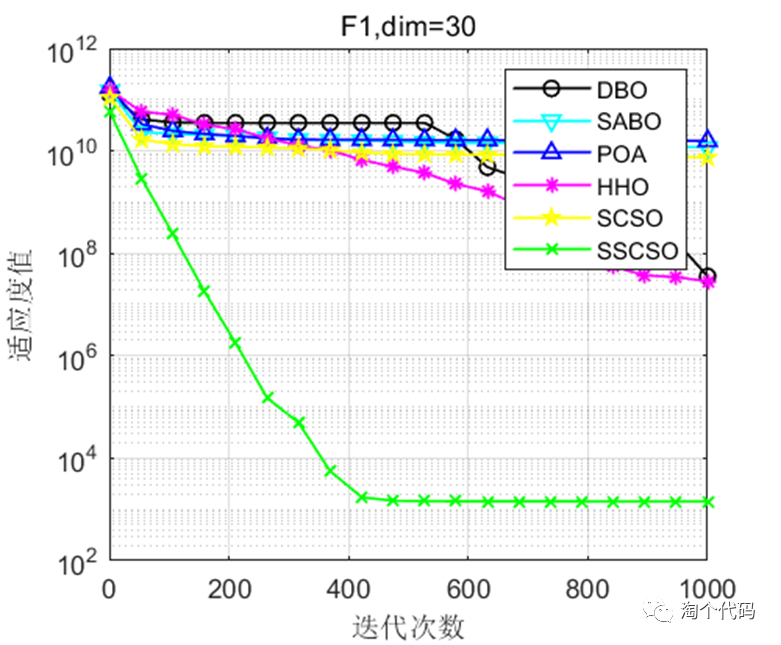
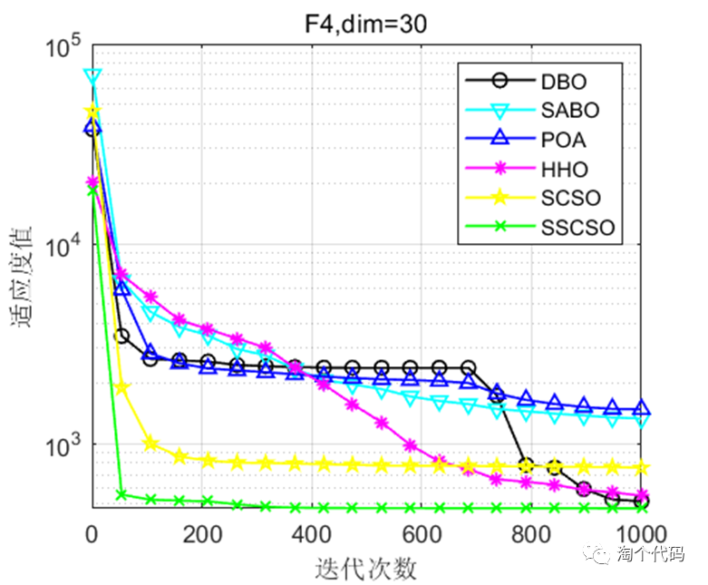
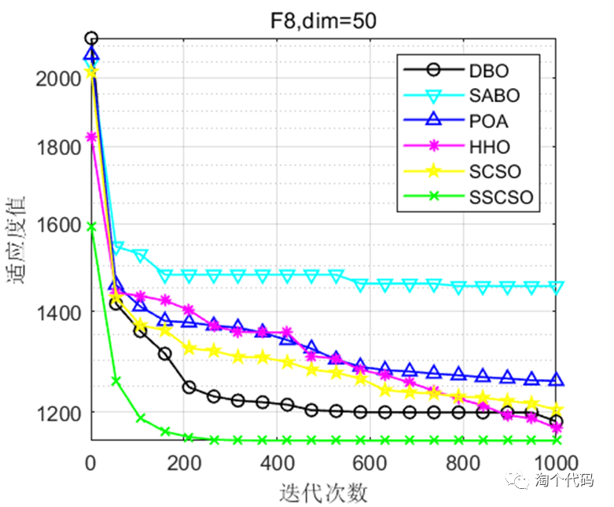
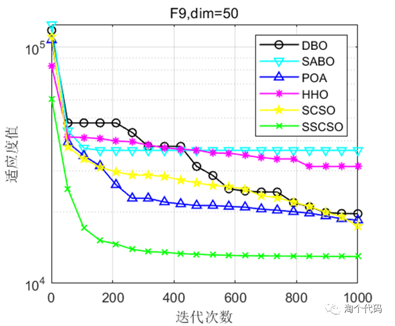
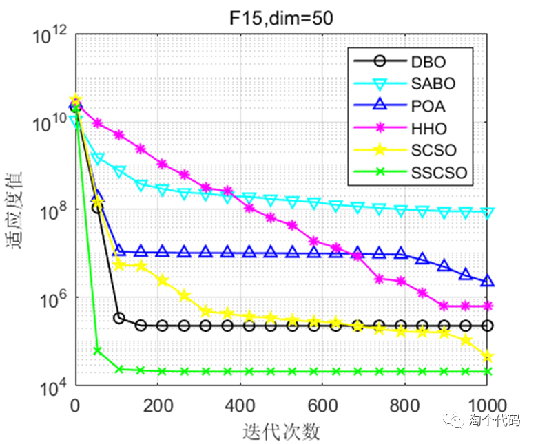
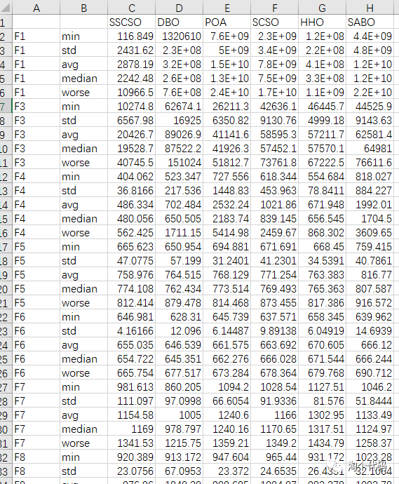
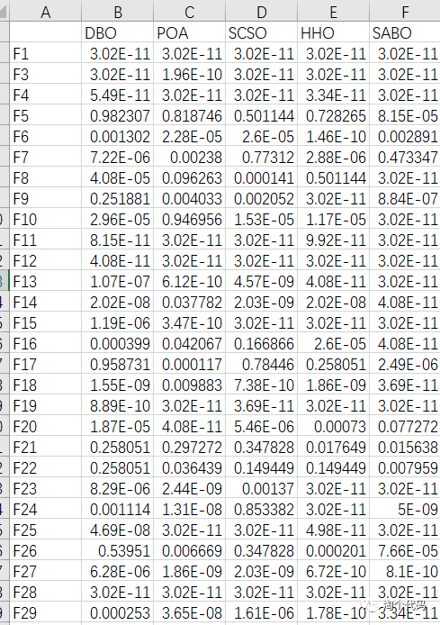
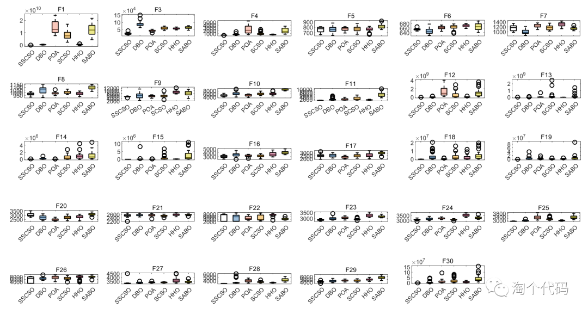
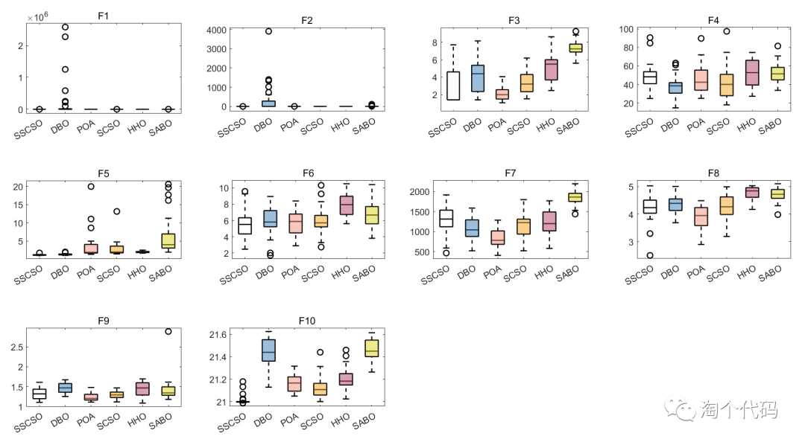
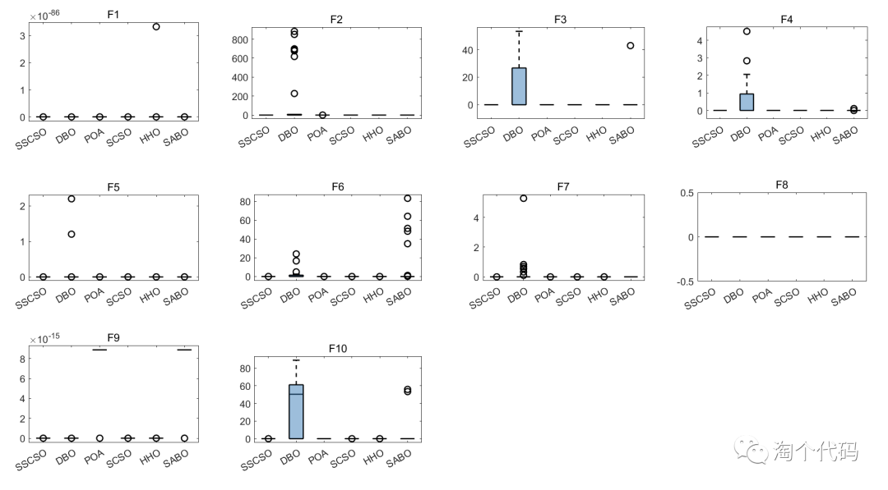
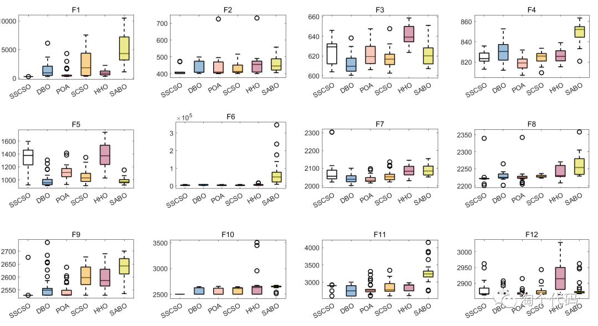

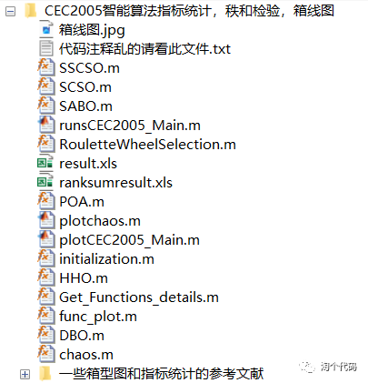

<!-- PAYMENT_BLOCK -->

## Get this dataset

- Payment link (Stripe): [Buy now](https://buy.stripe.com/3cs8yP7sY87d0vu9AB)
- Payment QR code: 

<!-- /PAYMENT_BLOCK -->
